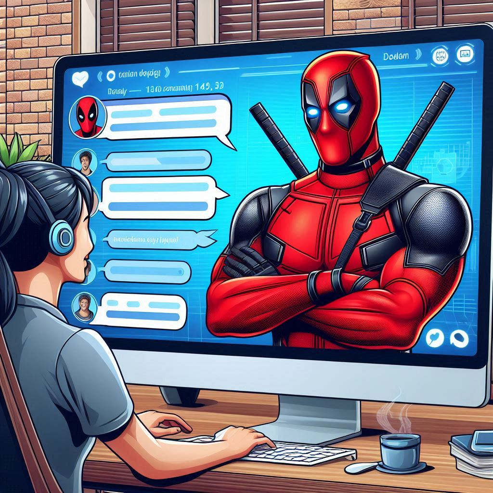

# Chatrager-AI: Custom Character RAG Chatbot

<p align="center">
  
</p>

<p align="center">
  <strong>An Intelligent, In-Character Retrieval-Augmented Generation (RAG) AI Chatbot built with Haystack 2.x, Qdrant Vector Database, and Groq LLM Inference.</strong>
</p>

<p align="center">
  
  
  
  
  
  
</p>

---

## 📖 Overview

**Chatrager-AI** is a state-of-the-art Custom Character RAG Chatbot. It enables users to select their favorite superhero from both **Marvel** and **DC** universes and engage in deeply immersive, authentic conversations. 

Rather than relying purely on generic LLM prompts, Chatrager-AI uses **Retrieval-Augmented Generation (RAG)**:
1. When a user asks a question, dense semantic embeddings are generated via `BAAI/bge-small-en-v1.5`.
2. Relevant canonical movie script dialogues and character quotes are retrieved from a localized **Qdrant Vector Database**.
3. The retrieved dialogue history, character aliases, tone guidelines, and user prompt are synthesized into a custom prompt template.
4. **Groq's LPU-accelerated inference** (`openai/gpt-oss-120b`, `qwen/qwen3.8-27b`, or `openai/gpt-oss-20b`) generates a response that faithfully mimics the character's vocabulary, mannerisms, humor, and worldview.
5. The UI surfaces both the generated reply and the underlying movie dialogue citations for full transparency.

---

## ⚡ Key Highlights

- **18 Iconic Characters Across Marvel & DC**:
  - **DC**: Batman, Superman, Wonder Woman
  - **Marvel**: Spiderman, Ironman, Captain America, Deadpool, Thor, Hulk, Black Widow, Thanos, Doctor Strange, Groot, Rocket, Star Lord, Drax, Vision, Jarvis
- **RAG Architecture with Haystack 2.x**:
  - `FastembedTextEmbedder` with ONNX acceleration
  - `QdrantEmbeddingRetriever` for top-k contextual retrieval
  - `PromptBuilder` with customized character persona prompting
  - `GroqGenerator`: High-speed custom Haystack component communicating with Groq's API
- **Modern Interactive Streamlit Interface**:
  - Filter heroes by universe (**Marvel** vs. **DC**)
  - Character Cards displaying secret identities, iconic taglines, and indexed movie script sources
  - Interactive suggested question chips for quick exploration
  - Transparent RAG source inspection (view retrieved dialogues and movie references)
  - Customizable LLM models and API settings

---

## 🏗️ System Architecture

```
                                 ┌─────────────────────────┐
                                 │   User Query / Input    │
                                 └────────────┬────────────┘
                                              │
                                              ▼
                             ┌─────────────────────────────────┐
                             │    FastEmbed Text Embedder      │
                             │     (BAAI/bge-small-en-v1.5)    │
                             └────────────────┬────────────────┘
                                              │
                                              ▼
                             ┌─────────────────────────────────┐
                             │     Qdrant Vector Database      │
                             │  (Local Collection per Hero)    │
                             └────────────────┬────────────────┘
                                              │
                                              ▼
                                 Retrieved Movie Dialogues
                                              │
                                              ▼
                             ┌─────────────────────────────────┐
                             │     Haystack PromptBuilder      │
                             │   (Persona + Tone + Context)    │
                             └────────────────┬────────────────┘
                                              │
                                              ▼
                             ┌─────────────────────────────────┐
                             │       Groq LLM Generator        │
                             │  (openai/gpt-oss-120b / Qwen)   │
                             └────────────────┬────────────────┘
                                              │
                                              ▼
                             ┌─────────────────────────────────┐
                             │   In-Character Response + RAG   │
                             │   Attribution in Streamlit UI   │
                             └─────────────────────────────────┘
```

---

## 📂 Project Structure

```
Chatrager-AI/
├── app.py                  # Streamlit web application & UI
├── query.py                # RAG retrieval and execution pipeline
├── utils.py                # Haystack 2.x components & GroqGenerator
├── preprocess.py           # Movie script parsing & dialogue extraction
├── index_data.py           # Dense vector embedding & Qdrant ingestion
├── config.yaml             # Character personas, movies, and Groq models
├── requirements.txt        # Python package dependencies
├── assets/                 # Project banners and visual assets
│   └── cover.jpeg
└── data/
    └── scripts/            # Canonical screenplay PDFs and transcripts
```

---

## 🚀 Getting Started

### 1. Clone the Repository

```bash
git clone https://github.com/pashikantipranathi/Chatrager-AI.git
cd Chatrager-AI
```

### 2. Install Dependencies

```bash
pip install -r requirements.txt
pip install haystack-ai qdrant-haystack fastembed fastembed-haystack groq streamlit python-dotenv
```

### 3. Setup Environment Variables

Create a `.env` file in the root directory:

```env
GROQ_API_KEY=your_groq_api_key_here
HAYSTACK_TELEMETRY_ENABLED=False
```

*(You can also configure the API key in `config.yaml` or enter it directly in the Streamlit sidebar).*

### 4. Vector Database Ingestion (Optional)

The dataset comes ready to run. To re-process scripts or add new characters:

```bash
# 1. Extract character dialogues from scripts
python3 preprocess.py

# 2. Embed and index dialogues into Qdrant
python3 index_data.py
```

### 5. Launch the Chatbot

```bash
streamlit run app.py
```

Open your browser at **`http://localhost:8501`**.

---

## 🦸 Supported Characters Matrix

| Superhero | Universe | Secret Identity | Screenplay Sources |
| :--- | :--- | :--- | :--- |
| **Batman** | DC | Bruce Wayne | *The Dark Knight Trilogy, Batman v Superman* |
| **Superman** | DC | Clark Kent | *Man of Steel, Batman v Superman* |
| **Wonder Woman** | DC | Diana Prince | *Wonder Woman (2017)* |
| **Spiderman** | Marvel | Peter Parker | *No Way Home, Civil War, Infinity War* |
| **Ironman** | Marvel | Tony Stark | *Iron Man, Avengers, Endgame, Ultron, Civil War* |
| **Captain America** | Marvel | Steve Rogers | *First Avenger, Winter Soldier, Civil War, Endgame* |
| **Deadpool** | Marvel | Wade Wilson | *Deadpool, Deadpool 2* |
| **Thor** | Marvel | Thor Odinson | *Thor, Ragnarok, Avengers, Infinity War* |
| **Hulk** | Marvel | Bruce Banner | *The Avengers, Infinity War, Endgame* |
| **Black Widow** | Marvel | Natasha Romanoff | *The Avengers, Civil War, Infinity War* |
| **Thanos** | Marvel | Thanos | *Avengers: Infinity War, Endgame* |
| **Doctor Strange** | Marvel | Stephen Strange | *Infinity War, Spider-Man: No Way Home* |
| **Groot** | Marvel | Groot | *Guardians of the Galaxy Vol 1 & 2* |
| **Rocket** | Marvel | Rocket | *Guardians of the Galaxy Vol 1 & 2* |
| **Star Lord** | Marvel | Peter Quill | *Guardians of the Galaxy Vol 1 & 2* |
| **Drax** | Marvel | Drax the Destroyer | *Guardians of the Galaxy Vol 1 & 2* |
| **Vision** | Marvel | Vision | *Age of Ultron, Civil War, Infinity War* |
| **Jarvis** | Marvel | J.A.R.V.I.S. | *Iron Man, The Avengers, Age of Ultron* |

---

## 📜 License

This project is licensed under the [MIT License](LICENSE).
